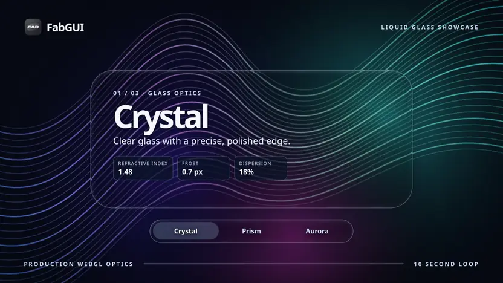

#  FabGUI

Browse and download your owned Epic Games / Fab library on Linux. FabGUI pairs [FabCLI](https://github.com/zirklerite/FabCLI) with a searchable card grid, tunable optical glass, and an installable desktop window that launches from KDE Plasma.




**Crystal → Prism → Aurora.** Watch the same rounded pane go from polished glass to deep bevels with 86% chromatic dispersion, then to soft frost, aurora, and caustic shimmer. The wide pane and the small mode bar both use FabGUI’s production WebGL shader.

Run the [QML showcase](docs/demos/FabGUIShowcase.qml) from the checkout with Qt 6 Quick and Qt WebEngine (WebGL 2 required):

```bash
qml6 docs/demos/FabGUIShowcase.qml
```

Press **Space** to pause or resume and **R** to replay. No Fab account or backend is required. The [four-second low-frost loop](docs/screenshots/fabgui-glass-demo.gif) is also available.

<details>
<summary>Run the showcase on a virtual display</summary>

If Qt WebEngine blocks WebGL 2 on a virtual display, the bundled local demo can run with software OpenGL:

```bash
LIBGL_ALWAYS_SOFTWARE=1 QTWEBENGINE_CHROMIUM_FLAGS=--ignore-gpu-blocklist qml6 docs/demos/FabGUIShowcase.qml
```

</details>

<details>
<summary>Earlier library and appearance screenshots</summary>


</details>

## Features

- **Owned library** — browse thumbnails, categories, distribution formats, and listed engine versions. Search your library, filter by engine, format, category, or platform, and sort by **Latest engine** or **A–Z**. FabGUI remembers your view.
- **Complete Projects, Code Plugins, and Asset Packs** — download listings from your owned library. Pick an engine version and compatible target platform in the download dialog. The progress pane stays docked during downloads and for **10 seconds** after the last job finishes, so you can see **Done! · 100%**.
- **Standalone desktop app** — install from Brave, Chrome, or another Chromium-compatible browser and launch it from your app menu with the translucent graphite FAB icon.
- **Tunable optical glass** — refracts wallpaper, video, and procedural backgrounds across the interface. Adjust the optics and effects, then save your own presets. Refractive notifications dismiss after **8 seconds**.
- **Copy listing UID** — right-click a card to copy its Fab listing UID.
- **Authentication** — sign in or out and view Epic/Fab session and account status (auth panel at the bottom of the page).

Use the **Format** filter to show Complete Projects, Code Plugins, or Asset Packs. Engine version and distribution format come from Fab’s library metadata.

## Platform support

FabGUI requires Python 3.8+ (standard library only), [FabCLI](https://github.com/zirklerite/FabCLI), and a systemd user session for the installer-managed service. The installer checks `/etc/os-release` and the distro's package manager.

| Linux family | Manager | Runtime packages |
| --- | --- | --- |
| Arch, CachyOS, and compatible derivatives | `pacman` | `python`, `webkit2gtk-4.1`, `ffmpeg` |
| Debian, Ubuntu, and compatible derivatives | `apt-get` | `python3`, `libwebkit2gtk-4.1-0`, `ffmpeg` |
| Fedora and compatible DNF-based RPM distributions | `dnf` / `dnf5` | `python3`, `webkit2gtk4.1`, `ffmpeg-free` or an existing FFmpeg package |

WebKitGTK brings in the GTK and WebView libraries FabCLI links against. FFmpeg converts uploaded background videos to muted H.264 MP4. FabGUI uses x264 when available and OpenH264 with Fedora’s stock `ffmpeg-free`. DNF resolves the package providing `/usr/bin/ffmpeg`; an existing full FFmpeg installation is reused. The installer does not add repositories or swap installed FFmpeg packages. Derivatives must provide the listed packages; on Ubuntu, FFmpeg may require the `universe` repository.

The desktop install and launcher were tested on CachyOS with KDE Plasma. Package installation was tested in Ubuntu 24.04 and Fedora 44 containers.

Verify FabCLI is discoverable and its linked libraries resolve:

```bash
export PATH="$HOME/.local/bin:$PATH"
fabcli --help
ldd "$(command -v fabcli)" | grep 'not found' || true
```

## Fresh install

Install FabCLI first, then clone and install FabGUI as your normal user:

```bash
git clone https://github.com/LucipurrsDad/FabGUI.git
cd FabGUI
bash install.sh
```

The installer checks the required packages and uses `sudo` only when system packages are missing. It copies FabGUI to `~/.local/share/fabgui`, then enables and starts `fabgui.service` for your user. It preserves an existing `settings.json` and saved background video. Run it as your regular desktop user.

Open <http://127.0.0.1:8000> after installation.

### Install FabGUI as a desktop app

Open <http://127.0.0.1:8000> in Brave, Chrome, or another Chromium-compatible browser. Click **Install FabGUI** when offered, or install it from the browser’s address bar or menu. The browser opens FabGUI in a standalone window and adds it to the desktop application launcher. On KDE Plasma, find **FabGUI** in Applications and pin it to your panel if you want. The [graphite FAB icon](static/icons/fabgui.svg) ships with the app. Use the same URL and browser profile to keep your appearance settings.

The desktop app still uses the local `fabgui.service` and FabCLI. Fab downloads require the local backend and an internet connection. The service worker does not cache files or handle API requests.

## Updating

No Git checkout is needed to update an existing installation. Run this as the account that owns FabGUI (not with `sudo`):

```bash
curl -fsSL https://raw.githubusercontent.com/LucipurrsDad/FabGUI/main/update.sh | bash
```

The updater downloads the latest public `main` archive, replaces the installed `server.py` and `static/`, preserves settings and saved video, and restarts the `fabgui.service` user unit if present. To use a non-default install directory, set `FABGUI_DIR` before running the updater. To install the version in a local checkout instead, run `bash install.sh` from that checkout.

## Run and troubleshoot

Manage the service from your regular desktop-user terminal. **Do not prefix `systemctl --user` with `sudo`**; `sudo` changes users and loses the desktop user's D-Bus session connection. If you have some interesting errors or warnings pertaining to the fabgui.service or the FabGUI web app please open an issue ticket.

```bash 
systemctl --user status fabgui.service
systemctl --user restart fabgui.service
journalctl --user -u fabgui.service -n 100 --no-pager
```

The service serves the installed copy at `~/.local/share/fabgui/server.py`. If you previously launched FabGUI manually from a source checkout, that old process may still own port 8000 and serve the old page while systemd repeatedly fails to bind the port. Check the listener and service:

```bash
sudo ss -ltnp 'sport = :8000'
systemctl --user status fabgui.service
```

If the listener is a manually started FabGUI process, stop that specific process (for example, press Ctrl+C in the terminal where it was launched, or terminate its confirmed PID), then start the managed unit:

```bash
systemctl --user reset-failed fabgui.service
systemctl --user start fabgui.service
```

Confirm the service is running and that it serves the updated header markup:

```bash
systemctl --user show fabgui.service -p MainPID
curl -fsS http://127.0.0.1:8000/ | grep -n 'header-sort-tabs'
```

To run without systemd, use `python3 ~/.local/share/fabgui/server.py` and make sure no other process is already listening on port 8000.

To uninstall, use the browser's app menu to remove the desktop app. Run `systemctl --user disable --now fabgui.service`, remove `~/.config/systemd/user/fabgui.service`, and run `systemctl --user daemon-reload`. You can then remove `~/.local/share/fabgui` if you no longer need the server files, settings, or saved video. FabCLI and your downloaded assets are separate.

## Appearance settings

Click **Appearance** in the header. The panel opens to **Background**; use the tabs to switch sections. Choices are saved in this browser.

- **Glass** — tint, frost, refractive index and strength, thickness, bevel width and curvature, chromatic dispersion, specular highlights, caustic shimmer, and ambient color bleed. Frost defaults to 6 px for new or reset appearances; set it to 0 for clear glass. An index of `1.00` gives no bending.
- **Background** — choose **Lines**, **Video**, **Gold-Gate Dark**, **Gold-Gate Light**, or **40th Anniversary**. Select **Video** to upload a clip and manage playback, looping, and speed in the same place. The local server stores one video clip at a time. Wallpapers preview as you select them. Effects include dimming, bloom, procedural aurora, particles, film grain, and vignette.
- **Motion** — control line and effects animation and scroll parallax. Decorative animation respects the browser's reduced-motion preference.
- **Presets** — select **Clear Glass**, **Soft Frost**, or **Aurora Glow** without changing your wallpaper or video. **Save custom preset** saves the current appearance under a name. **Reset to defaults** keeps your custom presets and uploaded video. **Restore saved appearance** applies the last custom preset you saved.

The WebGL 2 renderer adapts the optics from [NaughtyDuk's liquidGL](https://github.com/naughtyduk/liquidGL) (MIT) and uses Snell's law to sample the viewport backdrop in CSS-pixel units. All glass panels use the same shader. If WebGL 2 is unavailable, Appearance shows a graphics availability message. FabGUI does not request a WebGPU adapter. A synchronous XHR warning from AdGuard's `content-script-start.js` belongs to the extension.

## Layout

- `server.py` — Python HTTP server and FabCLI wrapper.
- `static/index.html` — page structure, header, download modal, auth panel, background lines.
- `static/app.js` — library loading, search, filters, sorting, card behavior, download flow, auth UI.
- `static/style.css` — shared styling.
- `static/appearance.css` and `static/appearance.js` — appearance settings, media controls, and surface styling.
- `static/liquidGL/` — optical shader and viewport compositor.
- `static/engine-sort.js` — engine-cap filter/sort overrides.
- `static/LIQUIDGL-NOTICE.txt` — liquidGL attribution and license notice.
- `static/manifest.json`, `static/install-app.js`, `static/service-worker.js`, and `static/icons/` — desktop PWA integration.
- `static/backgrounds/` — Gold-Gate and 40th Anniversary wallpapers.
- `backgrounds/` — project source wallpapers (synced to static/backgrounds/).
- `settings.json` — runtime settings.
- `install.sh` — userspace installer for Arch/pacman, Debian/Ubuntu/apt, and Fedora/DNF systems.
- `update.sh` — updater for the latest public `main` version.

## License

GPL-3.0
